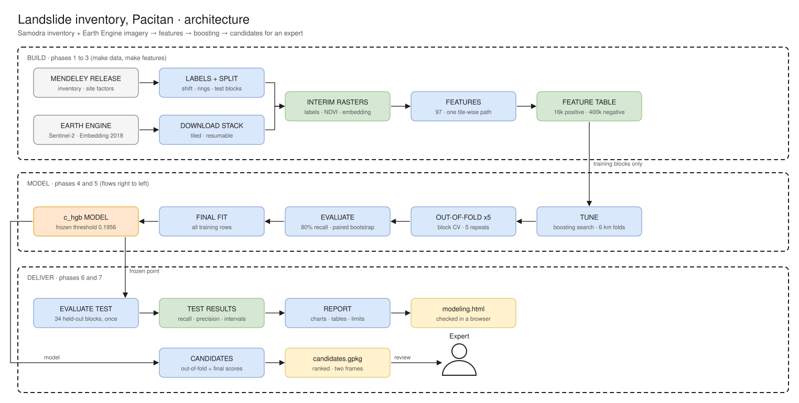

# Landslide detection, Pacitan (Cyclone Cempaka, Nov 2017)

A screening aid that flags candidate landslide scars from Sentinel-2 and Google Satellite Embedding, so an expert reviews flagged objects instead of
digitizing the whole area by hand. Reference labels: the Samodra et al. 2024 inventory (743 polygons).

## Result (held-out test blocks, scored once)
| | target | test result (95% interval) |
|---|---|---|
| object recall, polygons of 500 m2 or more | 80% or more | **86.8%** (79.0 to 93.1): met |
| object precision | 30% or more | **9.0%** (6.7 to 11.5): **not met** |

The model flags 1.0% of the area and about 10 false objects per true scar (baselines: about 31). A blinded review shows most large false alarms are bare
ground that is not a landslide (terraces, river banks, roads), not unmapped scars. Details, limits and the options tried and rejected: `reports/modeling.html`.
Dated decisions: `docs/decisions-log.md`; validation design: `docs/validation-design.md`.

## How it works


Block cross-validation (3 km blocks) on the training blocks, models compared at 80% object recall; the 34 test blocks were scored once with the frozen model.

## Deliverable
`data/processed/candidates_cempaka_pacitan.gpkg` (not committed): 5,865 candidate objects, ranked by probability, in two layers: `candidates_s2_grid` (where the model works) and
`candidates_inventory_frame` (shifted back by -8.4 m E, -9.4 m N to overlay the manual inventory as published). Review the 1,678 large objects (20 pixels or more) first.
Overview: `reports/figures/candidates_map.png`.

## Data sources and credit
- Labels and site factors (slope, elevation, rivers, roads, land use, lithology): Samodra et al. 2024, Mendeley Data, DOI 10.17632/vrtx3w6mjd.1, CC BY 4.0 (the article is CC BY-NC).
- Imagery: Sentinel-2 L1C (contains modified Copernicus Sentinel data 2017 to 2018) with Cloud Score+ masks (Google; its licence is not checked here), via Google Earth Engine.
- "The AlphaEarth Foundations Satellite Embedding dataset is produced by Google and Google DeepMind." (Satellite Embedding V1 annual, 2018; CC BY 4.0.)
- No data is committed (`data/` is gitignored).

## How to run
```
uv sync
cp .env.example .env              # set EARTHENGINE_PROJECT (and SSL_CERT_FILE if the Python has no certificates)
uv run earthengine authenticate --auth_mode=notebook --scopes=https://www.googleapis.com/auth/earthengine
make data features validation      # download the stack, labels, split, feature table, checks
make model                         # tuning, 5 out-of-fold repeats, evaluation, final fit (about 1 hour)
make rehearsal                     # the evaluation on training blocks only
LANDSLIDE_FINAL_EVAL=1 uv run python -W ignore -m src.modeling.evaluate_test   # once: scores the test blocks
make deliver                       # candidates GeoPackage, map, report
```
The project notes for a new session are in `CLAUDE.md`.

## Layout
`src/data` labels, split, loaders and checks · `src/ingestion` Earth Engine download · `src/features` the 97 features and their checks · `src/modeling` tuning, out-of-fold,
final fit, object metrics, evaluation · `src/delivery` candidates and map · `src/analysis` EDA and report · `docs/` decisions, validation design, plan, architecture · `reports/` HTML, figures, tables.
